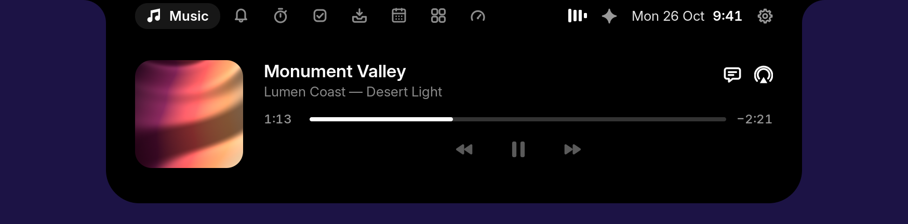

<div align="center">

# Keenu

**A notch-style island for your desktop.**

Music with synced lyrics, your calendar, a clipboard history, a file shelf, voice, and coding agents asking
you right there, in a small island at the top of your screen.

[](LICENSE)




</div>

> **Status: alpha.** Keenu is usable on Windows and on Linux with GNOME, and has not had a stable release. macOS
> support compiles but **has never been run on a Mac**. [What works where](docs/platform-support.md) says exactly
> what has and has not been tested, on what.

## What it does

Everything that watches, listens or reaches the network **starts off**, and you turn on what you want.

| | Windows 10/11 | Linux (GNOME 46–51) | macOS 11+ |
|---|---|---|---|
| **Music**: sessions, controls, cover art | Every app in the volume flyout | Any MPRIS player | Music and Spotify only ¹ |
| **Synced lyrics**: local `.lrc`, optional [LRCLIB](https://lrclib.net) | Yes | Yes | Untested |
| **Notifications** | Native toasts | The island's own | Basic, untested |
| **Calendar** | CalDAV, Google, Microsoft 365 ² | CalDAV through GNOME accounts | Untested |
| **Clipboard history**: opt-in, search, pins | Text, rich text, images, files | Text, images, files | Not yet |
| **File shelf**: by reference, never copied | Yes | Yes | Untested |
| **Voice**: only ever while you record | System speech or your own endpoint | whisper.cpp, with your AI | Not yet |
| **Claude Code and Codex approvals** | Yes | Yes | Not yet |
| **App usage**: opt-in, local | Yes | Yes | Untested |
| **Signed updates** | Built; needs a certificate to use ³ | Tells you a new version is out | Not yet |

¹ macOS has no public way to read every app's playback.
² Google and Microsoft need [a client ID of your own](docs/calendar-setup.md).
³ See [release engineering](docs/release-engineering.md).

On Linux, Keenu is the GNOME Shell extension described in [the Linux guide](docs/linux.md), which also has a
focus timer, tasks, reminders, calls and an AI assistant that are not on the other systems yet.

## Install

There is no published release yet, so these work once one exists and the addresses below have been set:

```sh
# Linux and macOS
curl -fsSL https://YOUR-KEENU-DOMAIN/install.sh | sh
```
```powershell
# Windows
irm https://YOUR-KEENU-DOMAIN/install.ps1 | iex
```

To read a script before running it, which is a good idea with any script from the internet:

```sh
curl -fsSLO https://YOUR-KEENU-DOMAIN/install.sh
less install.sh
sh install.sh
```

Each one finds the right build for your system, checks it against its published SHA-256, installs it for your user
only, keeps your settings on upgrade, and needs no development tools. `sh install.sh --uninstall` and
`install.ps1 -Uninstall` take Keenu off again; your data stays until you delete it.

## Build from source

| | Linux, macOS | Windows |
|---|---|---|
| Check tools, build and start | `./dev.sh` | `.\dev.ps1` |
| Build | `./build.sh` | `.\build.ps1` |
| Test | `./test.sh` | `.\test.ps1` |

None of them install system software: they tell you what is missing. On Windows you need either Rust with the
Visual Studio C++ tools, or just Docker Desktop. See [CONTRIBUTING](CONTRIBUTING.md).

## Using it

The island sits at the top of your screen. Rest the pointer on it or click it to open it; drop files on it to park
them on the shelf. Tab moves between its buttons and Enter presses them; Escape closes it. On Windows and macOS
its icon in the tray or menu bar shows or quits it. `keenu --help` lists what it can do from a terminal.

When a coding agent needs permission, the island opens with the command and folder. It never allows anything by
itself: if you do not answer in time, or Keenu is closed, the agent asks in its own terminal as usual.

## Privacy

Keenu has no server of its own and no telemetry. What it keeps stays on your computer, and you can export or delete
it from Settings. [PRIVACY.md](PRIVACY.md) has the details and [SECURITY.md](SECURITY.md) says how to report a problem.

## Documentation

- [What works where](docs/platform-support.md), and the [acceptance matrix](docs/feature-acceptance-matrix.md) behind it
- [Architecture](docs/architecture.md)
- [Linux guide](docs/linux.md), [calendar setup](docs/calendar-setup.md) and [permissions](docs/permissions.md)
- [Security model](docs/security-model.md), [threat model](docs/threat-model.md) and [data retention](docs/data-retention.md)
- [Release engineering](docs/release-engineering.md) and [the move from earlier names](docs/branding-migration.md)
- [Support](SUPPORT.md), [contributing](CONTRIBUTING.md) and the [changelog](CHANGELOG.md)

## License

Keenu is free software under the [GNU General Public License](LICENSE), version 3 or later, with no warranty.

It is based on [Isle](https://github.com/zickrian/isle) by zickrian, whose copyright notices remain in the source.
[NOTICE](NOTICE) lists this and the other works it includes.
