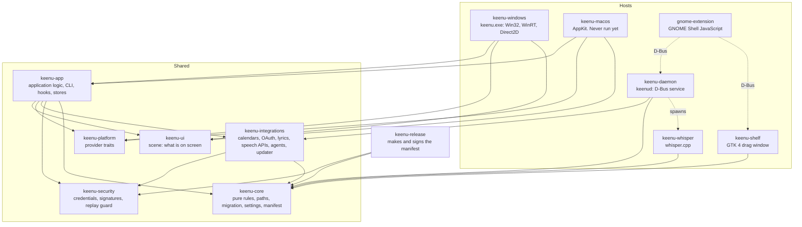
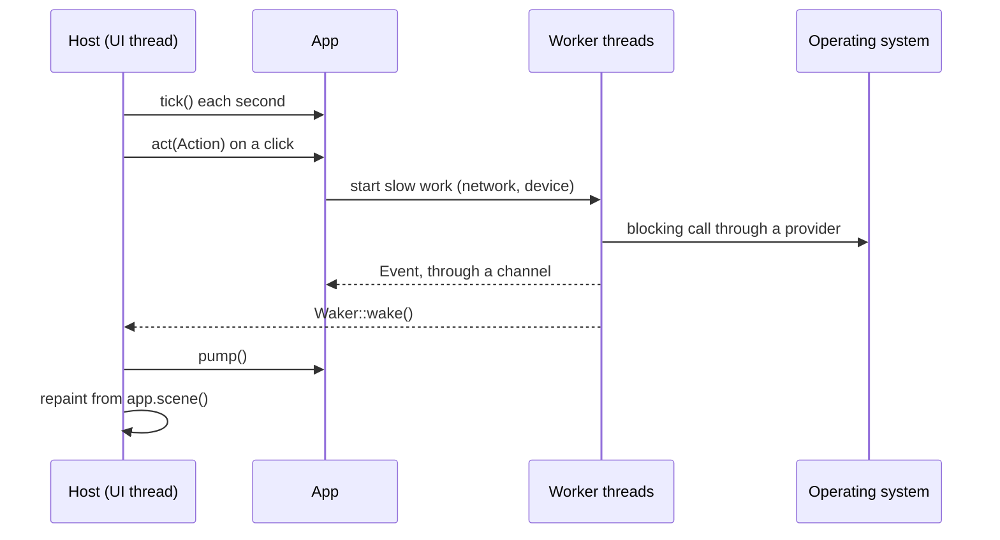
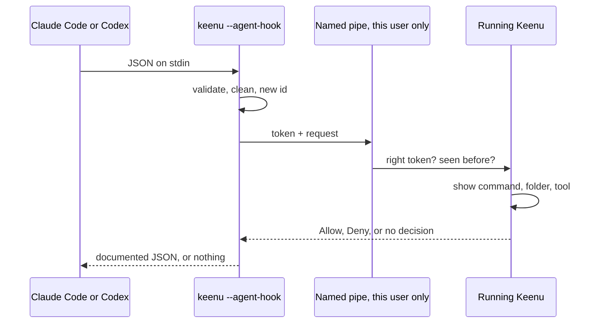

# Architecture

Keenu has one set of logic and a host per operating system. The rule: **a decision lives in shared, tested code; a
host only connects it to the operating system.**

## Dependency graph

`keenu-core`, `keenu-security`, `keenu-integrations`, `keenu-platform`, `keenu-ui`, `keenu-app` and `keenu-release`
build and test on every system, and CI runs them on all three.

## The two UI paths

**Windows and macOS** draw the island themselves. `keenu-ui` turns a `View` into a `Scene`: rounded rectangles, text,
polygons and clickable regions, in logical pixels. A host paints the scene and reports clicks and keys. So every
decision about what is on screen can be tested without a display, and a second host costs only a painter: Direct2D
and DirectWrite on Windows, `NSBezierPath` and attributed strings on macOS.

**Linux** keeps its own UI: a GNOME Shell extension, which has to run inside the shell and cannot be a separate
window. It talks over D-Bus to `keenud`, which uses the same `keenu-core` and `keenu-integrations`. Other Linux
desktops have no UI yet: see [platform support](platform-support.md).

It stays this way on purpose. The Linux edition is mature and works; replacing it would have risked that for no
user benefit.

## Provider interfaces

`keenu-platform` defines what Keenu needs from a system, and nothing about how it is done.

| Trait | Windows | macOS | Linux |
|---|---|---|---|
| `MediaProvider` | Global System Media Transport Controls | AppleScript to Music and Spotify | MPRIS, in `keenud` |
| `NotificationProvider` | WinRT toasts | `osascript` | The island, in the extension |
| `ClipboardProvider` | Win32 clipboard | `NSPasteboard` (text) | In the extension and `keenud` |
| `FileShelfProvider` | `ShellExecuteW`, `IShellItemImageFactory` | `open` | In the extension and `keenu-shelf` |
| `VoiceProvider` | `waveIn`, `ISpVoice`, System.Speech | `say` only | PipeWire, whisper.cpp, in `keenud` |
| `MonitorProvider` | `EnumDisplayMonitors` | `NSScreen` | GNOME Shell |
| `UsageProvider` | `GetForegroundWindow` | `NSWorkspace` | In the extension |
| `WindowLifecycleProvider` | `Run` registry key | Not yet | systemd user unit |
| `UpdateProvider` | MSI, `WinVerifyTrust` | Not yet | Notice only |
| `CalendarProvider` | `keenu-integrations`, the same everywhere | | GNOME's Online Accounts |

A capability a system lacks is reported through `Availability` with a reason a person can read, and the UI shows that
reason in place of a switch that would do nothing.

## How the application runs

`App` owns all state on the host's UI thread and is never shared. `refresh_view` rebuilds the whole `View` from what
is known, so what is on screen cannot drift from what is true.

## An agent's permission request

Printing nothing is the safe default in both agents' documented protocol: the agent then asks in its own terminal.
So a closed Keenu, a timeout or an unreadable request can never allow anything. See the
[security model](security-model.md).

## Where things are

| Path | What |
|---|---|
| `crates/` | The Rust crates above |
| `gnome-extension/` | The Linux UI |
| `data/` | Linux service files and the Inter font |
| `packaging/` | Windows MSI and NSIS, macOS bundle, AUR, Docker build images, icons |
| `scripts/` | Packaging, install scripts, smoke tests |
| `website/` | The download page, driven entirely by the release manifest |
| `tests/` | The extension's and the page's JavaScript tests |
| `docs/` | This documentation; `product-spec.md` defines the island's behaviour |

## Choices worth explaining

- **No web view or cross-platform toolkit.** The island is a small, always-on overlay, and each system's native 2D
  API gives its transparency and text with a 4 MB program. A toolkit would add far more than `keenu-ui` does.
- **`keenu-core` keeps no platform code**, so its rules can be tested in isolation. It predates this structure.
- **HTTP is blocking**, on worker threads. Nothing here needs thousands of connections, and `ureq` keeps the
  dependency tree small. TLS is the system's on Windows and macOS, and rustls on Linux.
- **The manifest is the one source of truth** for the updater, the install scripts and the page, so they cannot
  disagree about what exists.
- **Linux identifiers are unchanged** where renaming them would break installed extensions and saved settings. See
  [branding migration](branding-migration.md).
